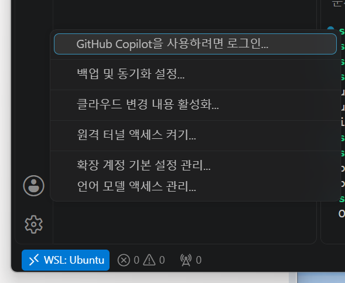
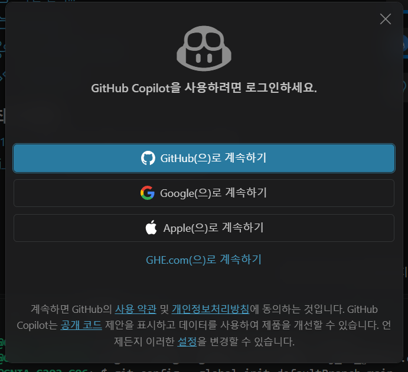
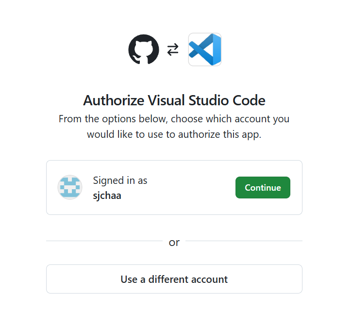
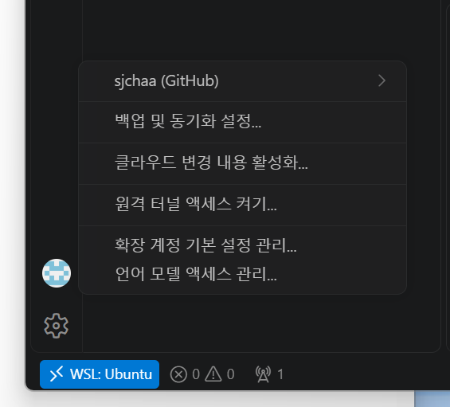

# 내 컴퓨터에 개발자용 '작업실' 꾸미기

## 1. 프로젝트 개요
- **목표:** 공용 PC 환경에서도 재현 가능하고 독립된 개발 워크스테이션(리눅스 CLI 터미널, Docker 컨테이너, Git/GitHub 버전 관리)을 구축하고, Docker 컨테이너 실행 및 볼륨·포트 검증 과정을 문서화하여 GitHub에 제출.

- **주요 활용 도구:** Linux CLI (Ubuntu/WSL2), Docker, Git & GitHub, VS Code.

## 2. 실행 환경
- **OS:** Ubuntu 26.04.1 LTS (WSL2 on Windows)
- **Shell:** Zsh (`/bin/zsh`)
- **Docker Version:** Docker version 29.9.3, build 5457199
- **Git Version:** git version 2.53.0

## 3. 수행 항목 체크리스트
✅ 터미널 기본 조작 및 폴더 구성 (`~/projects/myapp`)  
✅ 권한 변경 실습 (`chmod`, 소유권 및 접근 권한 `rwx` 확인)  
✅ Docker 설치 및 데몬 점검 (`docker info`)  
✅ `hello-world` 컨테이너 실행 성공  
✅ Dockerfile 작성 및 커스텀 웹 서버 이미지 빌드/실행  
✅ 포트 매핑 및 브라우저/curl 접속 검증  
✅ Docker 볼륨 영속성 및 바인드 마운트 검증  
✅ Git 설정 및 GitHub/VS Code 연동 완료  

## 4. 검증 방법 및 터미널 조작 로그
### (1) 현재 위치 확인

```
$ pwd
/home/sj_ee_6255/projects/myapp
```

### (2) 목록 확인(숨김 파일 포함) (ls -la)

```
sj_ee_6255@GNIA-C202-B06:~/projects/myapp$ la -la
total 24
drwxr-xr-x 3 sj_ee_6255 sj_ee_6255 4096 Nov  9 23:58 .
drwxr-xr-x 4 sj_ee_6255 sj_ee_6255 4096 Nov  9 22:53 ..
-rw-r--r-- 1 sj_ee_6255 sj_ee_6255   27 Nov  9 23:52 .envrc
drwxr-xr-x 5 sj_ee_6255 sj_ee_6255 4096 Nov  9 22:19 .venv
-rw-r--r-- 1 sj_ee_6255 sj_ee_6255 1220 Nov 10 00:35 README.md
-rw-r--r-- 1 sj_ee_6255 sj_ee_6255   76 Nov  9 23:02 index.html
```

### (3) 디렉토리 생성 및 이동 (mkdir, cd 명령어 사용)

```
sj_ee_6255@GNIA-C202-B06:~/projects/myapp$ mkdir test_dir
sj_ee_6255@GNIA-C202-B06:~/projects/myapp$ cd test_dir
sj_ee_6255@GNIA-C202-B06:~/projects/myapp/test_dir$ pwd
/home/sj_ee_6255/projects/myapp/test_dir
```

### (4) 빈 파일 생성 (touch 명령어 사용)
```
sj_ee_6255@GNIA-C202-B06:~/projects/myapp$ touch test.txt
sj_ee_6255@GNIA-C202-B06:~/projects/myapp$ ls -la
total 28
drwxr-xr-x 4 sj_ee_6255 sj_ee_6255 4096 Nov 10 23:28 .
drwxr-xr-x 4 sj_ee_6255 sj_ee_6255 4096 Nov  9 22:53 ..
-rw-r--r-- 1 sj_ee_6255 sj_ee_6255   27 Nov  9 23:52 .envrc
drwxr-xr-x 5 sj_ee_6255 sj_ee_6255 4096 Nov  9 22:19 .venv
-rw-r--r-- 1 sj_ee_6255 sj_ee_6255 1220 Nov 10 00:35 README.md
-rw-r--r-- 1 sj_ee_6255 sj_ee_6255   76 Nov  9 23:02 index.html
-rw-r--r-- 1 sj_ee_6255 sj_ee_6255    0 Nov 10 23:28 test.txt
drwxr-xr-x 2 sj_ee_6255 sj_ee_6255 4096 Nov 10 23:19 test_dir
```

### (5) 파일 내용 입력 및 확인 (echo, cat)

파일 내용을 입력하고 출력해 확인합니다.

```
sj_ee_6255@GNIA-C202-B06:~/projects/myapp$ echo "test 123456789" > test.txt
sj_ee_6255@GNIA-C202-B06:~/projects/myapp$ cat test.txt
test 123456789
```

### (6) 파일 복사 (cp)

파일을 다른 이름으로 복사합니다. 
test.txt 파일을 test1.txt로 복사합니다.


```
sj_ee_6255@GNIA-C202-B06:~/projects/myapp$ cp test.txt test_1.txt
sj_ee_6255@GNIA-C202-B06:~/projects/myapp$ ls -la
total 36
drwxr-xr-x 4 sj_ee_6255 sj_ee_6255 4096 Nov 10 23:36 .
drwxr-xr-x 4 sj_ee_6255 sj_ee_6255 4096 Nov  9 22:53 ..
-rw-r--r-- 1 sj_ee_6255 sj_ee_6255   27 Nov  9 23:52 .envrc
drwxr-xr-x 5 sj_ee_6255 sj_ee_6255 4096 Nov  9 22:19 .venv
-rw-r--r-- 1 sj_ee_6255 sj_ee_6255 1220 Nov 10 00:35 README.md
-rw-r--r-- 1 sj_ee_6255 sj_ee_6255   76 Nov  9 23:02 index.html
-rw-r--r-- 1 sj_ee_6255 sj_ee_6255   15 Nov 10 23:34 test.txt
-rw-r--r-- 1 sj_ee_6255 sj_ee_6255   15 Nov 10 23:36 test_1.txt
drwxr-xr-x 2 sj_ee_6255 sj_ee_6255 4096 Nov 10 23:19 test_dir
```

### (7) 파일 이동 및 이름 변경 (mv)

파일의 이름을 바꾸거나 위치를 이동합니다.  
복사한 test_1.txt 파일의 이름을 test_2.txt로 변경했습니다.

```
sj_ee_6255@GNIA-C202-B06:~/projects/myapp$ mv test_1.txt test_2.txt
sj_ee_6255@GNIA-C202-B06:~/projects/myapp$ ls -la
total 36
drwxr-xr-x 4 sj_ee_6255 sj_ee_6255 4096 Nov 10 23:39 .
drwxr-xr-x 4 sj_ee_6255 sj_ee_6255 4096 Nov  9 22:53 ..
-rw-r--r-- 1 sj_ee_6255 sj_ee_6255   27 Nov  9 23:52 .envrc
drwxr-xr-x 5 sj_ee_6255 sj_ee_6255 4096 Nov  9 22:19 .venv
-rw-r--r-- 1 sj_ee_6255 sj_ee_6255 1220 Nov 10 00:35 README.md
-rw-r--r-- 1 sj_ee_6255 sj_ee_6255   76 Nov  9 23:02 index.html
-rw-r--r-- 1 sj_ee_6255 sj_ee_6255   15 Nov 10 23:34 test.txt
-rw-r--r-- 1 sj_ee_6255 sj_ee_6255   15 Nov 10 23:36 test_2.txt
drwxr-xr-x 2 sj_ee_6255 sj_ee_6255 4096 Nov 10 23:19 test_dir
```

### (8) 디렉토리 및 파일 삭제 (rm -rf, rm)

디렉토리와 내부 파일까지 모두 삭제합니다.  
(디렉토리 삭제는 rm -rf 명령어를 사용하여 영구 삭제 했습니다.)

```
sj_ee_6255@GNIA-C202-B06:~/projects/myapp$ rm -rf test_dir
sj_ee_6255@GNIA-C202-B06:~/projects/myapp$ ls -la
total 32
drwxr-xr-x 3 sj_ee_6255 sj_ee_6255 4096 Nov 10 23:45 .
drwxr-xr-x 4 sj_ee_6255 sj_ee_6255 4096 Nov  9 22:53 ..
-rw-r--r-- 1 sj_ee_6255 sj_ee_6255   27 Nov  9 23:52 .envrc
drwxr-xr-x 5 sj_ee_6255 sj_ee_6255 4096 Nov  9 22:19 .venv
-rw-r--r-- 1 sj_ee_6255 sj_ee_6255 1220 Nov 10 00:35 README.md
-rw-r--r-- 1 sj_ee_6255 sj_ee_6255   76 Nov  9 23:02 index.html
-rw-r--r-- 1 sj_ee_6255 sj_ee_6255   15 Nov 10 23:34 test.txt
-rw-r--r-- 1 sj_ee_6255 sj_ee_6255   15 Nov 10 23:36 test_2.txt
```

텍스트 파일을 삭제합니다. 
test.txt와 test_2.txt 파일은 test_dir 가 아닌 상위 폴더에 있었기 때문에 별도로 삭제를 진행합니다.

```
sj_ee_6255@GNIA-C202-B06:~/projects/myapp$ rm test.txt test_2.txt
sj_ee_6255@GNIA-C202-B06:~/projects/myapp$ ls -la
total 24
drwxr-xr-x 3 sj_ee_6255 sj_ee_6255 4096 Nov 10 23:50 .
drwxr-xr-x 4 sj_ee_6255 sj_ee_6255 4096 Nov  9 22:53 ..
-rw-r--r-- 1 sj_ee_6255 sj_ee_6255   27 Nov  9 23:52 .envrc
drwxr-xr-x 5 sj_ee_6255 sj_ee_6255 4096 Nov  9 22:19 .venv
-rw-r--r-- 1 sj_ee_6255 sj_ee_6255 1220 Nov 10 00:35 README.md
-rw-r--r-- 1 sj_ee_6255 sj_ee_6255   76 Nov  9 23:02 index.html
```

## 5. 권한 실습 및 증거 기록

### (1) 권한 확인 (ls -l)

파일과 디렉토리의 현재 권한`rmw`를 확인하고, `chmod` 명령어를 통해 권한을 변경한 뒤 변경 전/후를  비교하였습니다.


#### ▷ 파일 권한 확인 및 변경

임의로 텍스트 파일을 생성한 후 권한 확인과 변경을 진행합니다.

touch 명령어로 파일 생성  
ls -l 명령어로 권한 확인  
chmod 명령어로 권한 변경 진행


```
sj_ee_6255@GNIA-C202-D06:~/E1-1/myapp$ touch abcdefg.txt
sj_ee_6255@GNIA-C202-D06:~/E1-1/myapp$ ls -l
total 12
-rw-r--r-- 1 sj_ee_6255 sj_ee_6255 6359 Nov 17 23:41 README.md
-rw-r--r-- 1 sj_ee_6255 sj_ee_6255    0 Nov 17 23:49 abcdefg.txt
-rw-r--r-- 1 sj_ee_6255 sj_ee_6255   76 Nov 17 21:55 index.html
```

chmod 755 명령어로 

소유자는 읽기/쓰기/실행  
그룹 사용자는 읽기/실행  
기타 사용자는 읽기/실행  

이 가능하도록 실행 권한을 추가했습니다.

```
sj_ee_6255@GNIA-C202-D06:~/E1-1/myapp$ chmod 755 abcdefg.txt
sj_ee_6255@GNIA-C202-D06:~/E1-1/myapp$ ls -l
total 12
-rw-r--r-- 1 sj_ee_6255 sj_ee_6255 6359 Nov 17 23:41 README.md
-rwxr-xr-x 1 sj_ee_6255 sj_ee_6255    0 Nov 17 23:49 abcdefg.txt
-rw-r--r-- 1 sj_ee_6255 sj_ee_6255   76 Nov 17 21:55 index.html
```

#### ▷ 파일 권한 변경 전후 비교

- **변경 전 권한 (`-rw-r--r--`):** 소유자(읽기/쓰기),  
그룹(읽기 전용), 기타 사용자(읽기 전용) 상태이며 실행 권한이 없습니다.

- **변경 후 권한 (`-rwxr-xr-x`):** `chmod 755` 명령어 적용 후,  
소유자와 그룹, 기타 사용자 모두에게 실행(`x`) 권한이 추가/변경된 것을 확인할 수 있습니다.

```
# 변경 전
-rw-r--r-- 1 sj_ee_6255 sj_ee_6255    0 Nov 17 23:49 abcdefg.txt

# 변경후
-rwxr-xr-x 1 sj_ee_6255 sj_ee_6255    0 Nov 17 23:49 abcdefg.txt
```


#### ▷ 디렉토리 권한 확인 및 변경

디렉토리를 생성하고 권한을 확인합니다.

```
sj_ee_6255@GNIA-C202-D06:~/E1-1/myapp$ mkdir abcdefg_dir
sj_ee_6255@GNIA-C202-D06:~/E1-1/myapp$ ls -l
total 16
-rw-r--r-- 1 sj_ee_6255 sj_ee_6255 6359 Nov 17 23:41 README.md
-rwxr-xr-x 1 sj_ee_6255 sj_ee_6255    0 Nov 17 23:49 abcdefg.txt
drwxr-xr-x 2 sj_ee_6255 sj_ee_6255 4096 Nov 18 00:05 abcdefg_dir
-rw-r--r-- 1 sj_ee_6255 sj_ee_6255   76 Nov 17 21:55 index.html
```

현재 새롭게 생성한 디렉토리의 권한은

소유자는 읽기/쓰기/실행  
그룹 사용자는 읽기/실행  
기타 사용자는 읽기/실행

이 가능했으며, 소유주가 아닌 그룹 사용자와 기타 사용자의 모든 권한을 해제했습니다.

```
sj_ee_6255@GNIA-C202-D06:~/E1-1/myapp$ chmod 700 abcdefg_dir
sj_ee_6255@GNIA-C202-D06:~/E1-1/myapp$ ls -l
total 16
-rw-r--r-- 1 sj_ee_6255 sj_ee_6255 6359 Nov 17 23:41 README.md
-rwxr-xr-x 1 sj_ee_6255 sj_ee_6255    0 Nov 17 23:49 abcdefg.txt
drwx------ 2 sj_ee_6255 sj_ee_6255 4096 Nov 18 00:05 abcdefg_dir
-rw-r--r-- 1 sj_ee_6255 sj_ee_6255   76 Nov 17 21:55 index.html
```

#### ▷ 디렉토리 권한 변경 전후 비교

소유자 외의 모든 접근을 차단하는 `chmod 700` 명령어를 수행하여 변경 전후를 비교하였습니다.

- **변경 전 권한 (`drwxr-xr-x`):** 소유자는 모든 권한(읽기/쓰기/실행), 그룹 및 기타 사용자는 읽기 및 실행(조회)이 가능한 상태입니다.
- **변경 후 권한 (`drwx------`):** `chmod 700` 적용 후, 오직 소유자만 접근 및 조회가 가능하도록 보안이 강화되었습니다.

```
# 변경 전
drwxr-xr-x 2 sj_ee_6255 sj_ee_6255 4096 Nov 18 00:05 abcdefg_dir

# 변경후
drwx------ 2 sj_ee_6255 sj_ee_6255 4096 Nov 18 00:05 abcdefg_dir 
```

## 6. Docker 설치 및 기본 점검

### 6-1. Docker 버전 확인 및 결과

```
sj_ee_6255@GNIA-C202-D06:~/E1-1/myapp$ docker --version
Docker version 29.9.3, build 5457199
```

### 6-2. Docker 데몬 동작 여부 확인 및 결과

```
sj_ee_6255@GNIA-C202-D06:~/E1-1/myapp$ docker info
Client:
 Version:    29.9.3
 Context:    default
 Debug Mode: false
 Plugins:
  agent: Docker AI Agent Runner (Docker Inc.)
    Version:  v1.153.0
    Path:     C:\Program Files\Docker\cli-plugins\docker-agent.exe
  ai: Docker AI Agent - Ask Gordon (Docker Inc.)
    Version:  v1.33.0
    Path:     C:\Program Files\Docker\cli-plugins\docker-ai.exe
  buildx: Docker Buildx (Docker Inc.)
    Version:  v0.38.1
    Path:     C:\Program Files\Docker\cli-plugins\docker-buildx.exe
  compose: Docker Compose (Docker Inc.)
    Version:  v5.7.0
    Path:     C:\Program Files\Docker\cli-plugins\docker-compose.exe
  debug: Get a shell into any image or container (Docker Inc.)
    Version:  0.49.0
    Path:     C:\Program Files\Docker\cli-plugins\docker-debug.exe
  desktop: Docker Desktop commands (Docker Inc.)
    Version:  4.99.0
    Path:     C:\Program Files\Docker\cli-plugins\docker-desktop.exe
  dhi: CLI for managing Docker Hardened Images (Docker Inc.)
    Version:  v0.0.10
    Path:     C:\Program Files\Docker\cli-plugins\docker-dhi.exe
  extension: Manages Docker extensions (Docker Inc.)
    Version:  v0.2.32
    Path:     C:\Program Files\Docker\cli-plugins\docker-extension.exe
  init: Creates Docker-related starter files for your project (Docker Inc.)
    Version:  v1.4.1
    Path:     C:\Program Files\Docker\cli-plugins\docker-init.exe
  mcp: Docker MCP Plugin (Docker Inc.)
    Version:  v0.44.3
    Path:     C:\Program Files\Docker\cli-plugins\docker-mcp.exe
  model: Docker Model Runner (Docker Inc.)
    Version:  v1.2.9
    Path:     C:\Program Files\Docker\cli-plugins\docker-model.exe
  offload: Docker Offload (Docker Inc.)
    Version:  v0.7.36
    Path:     C:\Program Files\Docker\cli-plugins\docker-offload.exe
  pass: Docker Pass Secrets Manager Plugin (beta) (Docker Inc.)
    Version:  v0.3.2
    Path:     C:\Program Files\Docker\cli-plugins\docker-pass.exe
  sandbox: "docker sandbox" is deprecated, use Docker Sandboxes instead (Docker Inc.)
    Version:  v0.13.0
    Path:     C:\Program Files\Docker\cli-plugins\docker-sandbox.exe
  scout: Docker Scout (Docker Inc.)
    Version:  v1.28.0
    Path:     C:\Program Files\Docker\cli-plugins\docker-scout.exe

Server:
failed to connect to the docker API at npipe:////./pipe/docker_engine; check if the path is correct and if the daemon is running: open //./pipe/docker_engine: The system cannot find the file specified.
```

## 7. Docker 기본 운영 명령 수행

### 7-1. 이미지 : 다운로드/목록 확인

Nginx 웹서버 이미지를 원격 저장소에서 다운로드(`pull`)하고,  
로컬에 저장된 이미지 목록을 확인(`images`)했습니다.


- **이미지 다운로드**

```
sj_ee_6255@GNIA-C202-D06:~/E1-1/myapp$ sudo docker pull nginx:alpine
alpine: Pulling from library/nginx
881fc932939e: Pull complete
1abafee971b9: Pull complete
c7dfd64eeb02: Pull complete
e011f124249b: Pull complete
a746bd1dc828: Pull complete
b9c6ee6a30f8: Pull complete
69d81d552257: Pull complete
da90db506dd5: Pull complete
Digest: sha256:fed7e14be83cbd2661a75cdc5b872d936cf155d46c327084d30b8df19ae88d72
Status: Downloaded newer image for nginx:alpine
docker.io/library/nginx:alpine
```

- **이미지 목록 확인**  
```
sj_ee_6255@GNIA-C202-D06:~/E1-1/myapp$ sudo docker images
                                                                                                    i Info →   U  In Use
IMAGE          ID             DISK USAGE   CONTENT SIZE   EXTRA
nginx:alpine   7cac34a4d72b         63MB             0B
```

## 7-2. 컨테이너 : 실행/중지/목록 확인 (예: docker ps, dockr ps -a)

- **컨테이너 실행** hello-world

```
sj_ee_6255@GNIA-C202-D06:~/E1-1/myapp$ sudo docker run hello-world
Unable to find image 'hello-world:latest' locally
latest: Pulling from library/hello-world
4f55086f7dd0: Pull complete
Digest: sha256:1e4c05b897a751332ce85c7e9449da2d93514ea2dea6dbb0e2753c9e949b2bfa
Status: Downloaded newer image for hello-world:latest

Hello from Docker!
This message shows that your installation appears to be working correctly.

To generate this message, Docker took the following steps:
 1. The Docker client contacted the Docker daemon.
 2. The Docker daemon pulled the "hello-world" image from the Docker Hub.
    (amd64)
 3. The Docker daemon created a new container from that image which runs the
    executable that produces the output you are currently reading.
 4. The Docker daemon streamed that output to the Docker client, which sent it
    to your terminal.

To try something more ambitious, you can run an Ubuntu container with:
 $ docker run -it ubuntu bash

Share images, automate workflows, and more with a free Docker ID:
 https://hub.docker.com/

For more examples and ideas, visit:
 https://docs.docker.com/get-started/
 ```

- **Nginx 웹서버 컨테이너 실행** 

  다운로드한 `nginx:alpine` 이미지를 기반으로 백그라운드에서 동작하는 웹서버 컨테이너를 생성 및 실행하였습니다.

  -d (Detached mode): 컨테이너를 백그라운드(화면 뒤쪽)에서 실행하여 터미널을 계속 사용할 수 있게 합니다. 
  
  --name my-nginx-container: 컨테이너의 이름을 my-nginx-container로 명시적으로 지정하여 관리하기 쉽게 만듭니다. 
  
  -p 8080:80: 호스트(내 PC)의 8080 포트를 컨테이너 내부의 80 포트(Nginx 기본 포트)와 연결(포트 매핑)하여 외부에서 접속할 수 있도록 합니다.


```
sj_ee_6255@GNIA-C202-D06:~/E1-1/myapp$ sudo docker run -d --name my-nginx-container -p 8080:80 nginx:alpine
c384b6b43fc854092df79038bbb1345a1693c401c5fc42ecf4a7f5d135a9f290
```

- **컨테이너 목록 확인** 

현재 실행 중인 컨테이너 목록을 확인합니다. (docker ps)

```
sj_ee_6255@GNIA-C202-D06:~/E1-1/myapp$ sudo docker ps
CONTAINER ID   IMAGE          COMMAND                  CREATED         STATUS         PORTS                                     NAMES
c384b6b43fc8   nginx:alpine   "/docker-entrypoint.…"   4 minutes ago   Up 4 minutes   0.0.0.0:8080->80/tcp, [::]:8080->80/tcp   my-nginx-container
```

모든 컨테이너 목록 확인 (정지된 컨테이너 등 포함) (docker ps -a)  
처음 실행했던 hello-world도 함께 보여지는 것을 확인할 수 있습니다.

```
sj_ee_6255@GNIA-C202-D06:~/E1-1/myapp$ sudo docker ps
CONTAINER ID   IMAGE          COMMAND                  CREATED         STATUS         PORTS                                     NAMES
c384b6b43fc8   nginx:alpine   "/docker-entrypoint.…"   4 minutes ago   Up 4 minutes   0.0.0.0:8080->80/tcp, [::]:8080->80/tcp   my-nginx-container
sj_ee_6255@GNIA-C202-D06:~/E1-1/myapp$ sudo docker ps -a
CONTAINER ID   IMAGE          COMMAND                  CREATED          STATUS                      PORTS                                     NAMES
c384b6b43fc8   nginx:alpine   "/docker-entrypoint.…"   6 minutes ago    Up 6 minutes                0.0.0.0:8080->80/tcp, [::]:8080->80/tcp   my-nginx-container
c9bc242148a5   hello-world    "/hello"                 15 minutes ago   Exited (0) 15 minutes ago                                             unruffled_merkle
```

- **컨테이너 중지** (docker stop)

docker stop 명령어를 사용하여 컨테이너를 중지합니다.  
docker ps 명령어로 현재 실행중인 컨테이너 목록을 확인하였고,  
현재 실행중인 컨테이너가 없는 것이 확인됩니다.

```
sj_ee_6255@GNIA-C202-D06:~/E1-1/myapp$ sudo docker stop my-nginx-container
my-nginx-container
sj_ee_6255@GNIA-C202-D06:~/E1-1/myapp$ sudo docker ps
CONTAINER ID   IMAGE     COMMAND   CREATED   STATUS    PORTS     NAMES
```

## 7-3. 운영 : 로그 확인 (예: docker logs), 리소스 확인 (예: docker stats) 

- **로그 확인 (docker logs)**

컨테이너의 로그를 확인하기 위해 중지된 컨테이너를 다시 실행합니다.


기존 컨테이너를 다시 실행하는 명령어는 docker start 입니다.
(docker run 명령어를 사용하면 새로운 컨테이너가 처음부터 생성되며 실행되기 때문에 docker start 명령어를 사용합니다.)

컨테이너를 다시 실행하고 (docker start),  
제대로 실행되었는지 확인한 후 (docker ps)  
로그를 확인합니다. (docker logs)

```
sj_ee_6255@GNIA-C202-D06:~/E1-1/myapp$ sudo docker start my-nginx-container
my-nginx-container
sj_ee_6255@GNIA-C202-D06:~/E1-1/myapp$ sudo docker ps
CONTAINER ID   IMAGE          COMMAND                  CREATED          STATUS          PORTS                                     NAMES
c384b6b43fc8   nginx:alpine   "/docker-entrypoint.…"   23 minutes ago   Up 21 seconds   0.0.0.0:8080->80/tcp, [::]:8080->80/tcp   my-nginx-container
sj_ee_6255@GNIA-C202-D06:~/E1-1/myapp$ sudo docker logs my-nginx-container
/docker-entrypoint.sh: /docker-entrypoint.d/ is not empty, will attempt to perform configuration
/docker-entrypoint.sh: Looking for shell scripts in /docker-entrypoint.d/
/docker-entrypoint.sh: Launching /docker-entrypoint.d/10-listen-on-ipv6-by-default.sh
10-listen-on-ipv6-by-default.sh: info: Getting the checksum of /etc/nginx/conf.d/default.conf
10-listen-on-ipv6-by-default.sh: info: Enabled listen on IPv6 in /etc/nginx/conf.d/default.conf
/docker-entrypoint.sh: Sourcing /docker-entrypoint.d/15-local-resolvers.envsh
/docker-entrypoint.sh: Launching /docker-entrypoint.d/20-envsubst-on-templates.sh
/docker-entrypoint.sh: Launching /docker-entrypoint.d/30-tune-worker-processes.sh
/docker-entrypoint.sh: Configuration complete; ready for start up
2026/11/17 16:04:35 [notice] 1#1: using the "epoll" event method
2026/11/17 16:04:35 [notice] 1#1: nginx/1.31.8
2026/11/17 16:04:35 [notice] 1#1: built by gcc 15.2.0 (Alpine 15.2.0)
2026/11/17 16:04:35 [notice] 1#1: OS: Linux 6.18.58.1-microsoft-standard-WSL2
2026/11/17 16:04:35 [notice] 1#1: getrlimit(RLIMIT_NOFILE): 1048576:1048576
2026/11/17 16:04:35 [notice] 1#1: start worker processes
2026/11/17 16:04:35 [notice] 1#1: start worker process 30
2026/11/17 16:04:35 [notice] 1#1: start worker process 31
2026/11/17 16:04:35 [notice] 1#1: start worker process 32
2026/11/17 16:04:35 [notice] 1#1: start worker process 33
2026/11/17 16:04:35 [notice] 1#1: start worker process 34
2026/11/17 16:04:35 [notice] 1#1: start worker process 35
2026/11/17 16:04:35 [notice] 1#1: start worker process 36
2026/11/17 16:04:35 [notice] 1#1: start worker process 37
2026/11/17 16:04:35 [notice] 1#1: start worker process 38
2026/11/17 16:04:35 [notice] 1#1: start worker process 39
2026/11/17 16:04:35 [notice] 1#1: start worker process 40
2026/11/17 16:04:35 [notice] 1#1: start worker process 41
2026/11/17 16:04:35 [notice] 1#1: start worker process 42
2026/11/17 16:04:35 [notice] 1#1: start worker process 43
2026/11/17 16:04:35 [notice] 1#1: start worker process 44
2026/11/17 16:04:35 [notice] 1#1: start worker process 45
2026/11/17 16:04:35 [notice] 1#1: start worker process 46
2026/11/17 16:04:35 [notice] 1#1: start worker process 47
2026/11/17 16:04:35 [notice] 1#1: start worker process 48
2026/11/17 16:04:35 [notice] 1#1: start worker process 49
2026/11/17 16:04:35 [notice] 1#1: start worker process 50
2026/11/17 16:04:35 [notice] 1#1: start worker process 51
2026/11/17 16:04:35 [notice] 1#1: start worker process 52
2026/11/17 16:04:35 [notice] 1#1: start worker process 53
2026/11/17 16:19:38 [notice] 1#1: signal 3 (SIGQUIT) received, shutting down
2026/11/17 16:19:38 [notice] 31#31: gracefully shutting down
2026/11/17 16:19:38 [notice] 30#30: gracefully shutting down
2026/11/17 16:19:38 [notice] 32#32: gracefully shutting down
2026/11/17 16:19:38 [notice] 33#33: gracefully shutting down
2026/11/17 16:19:38 [notice] 32#32: exiting
2026/11/17 16:19:38 [notice] 33#33: exiting
2026/11/17 16:19:38 [notice] 31#31: exiting
2026/11/17 16:19:38 [notice] 30#30: exiting
2026/11/17 16:19:38 [notice] 46#46: gracefully shutting down
2026/11/17 16:19:38 [notice] 50#50: gracefully shutting down
2026/11/17 16:19:38 [notice] 46#46: exiting
2026/11/17 16:19:38 [notice] 50#50: exiting
2026/11/17 16:19:38 [notice] 32#32: exit
2026/11/17 16:19:38 [notice] 31#31: exit
2026/11/17 16:19:38 [notice] 33#33: exit
2026/11/17 16:19:38 [notice] 30#30: exit
2026/11/17 16:19:38 [notice] 46#46: exit
2026/11/17 16:19:38 [notice] 50#50: exit
2026/11/17 16:19:38 [notice] 51#51: gracefully shutting down
2026/11/17 16:19:38 [notice] 51#51: exiting
2026/11/17 16:19:38 [notice] 43#43: gracefully shutting down
2026/11/17 16:19:38 [notice] 52#52: gracefully shutting down
2026/11/17 16:19:38 [notice] 52#52: exiting
2026/11/17 16:19:38 [notice] 43#43: exiting
2026/11/17 16:19:38 [notice] 47#47: gracefully shutting down
2026/11/17 16:19:38 [notice] 45#45: gracefully shutting down
2026/11/17 16:19:38 [notice] 47#47: exiting
2026/11/17 16:19:38 [notice] 34#34: gracefully shutting down
2026/11/17 16:19:38 [notice] 45#45: exiting
2026/11/17 16:19:38 [notice] 34#34: exiting
2026/11/17 16:19:38 [notice] 51#51: exit
2026/11/17 16:19:38 [notice] 41#41: gracefully shutting down
2026/11/17 16:19:38 [notice] 52#52: exit
2026/11/17 16:19:38 [notice] 45#45: exit
2026/11/17 16:19:38 [notice] 43#43: exit
2026/11/17 16:19:38 [notice] 44#44: gracefully shutting down
2026/11/17 16:19:38 [notice] 41#41: exiting
2026/11/17 16:19:38 [notice] 44#44: exiting
2026/11/17 16:19:38 [notice] 40#40: gracefully shutting down
2026/11/17 16:19:38 [notice] 37#37: gracefully shutting down
2026/11/17 16:19:38 [notice] 47#47: exit
2026/11/17 16:19:38 [notice] 37#37: exiting
2026/11/17 16:19:38 [notice] 40#40: exiting
2026/11/17 16:19:38 [notice] 34#34: exit
2026/11/17 16:19:38 [notice] 42#42: gracefully shutting down
2026/11/17 16:19:38 [notice] 53#53: gracefully shutting down
2026/11/17 16:19:38 [notice] 42#42: exiting
2026/11/17 16:19:38 [notice] 53#53: exiting
2026/11/17 16:19:38 [notice] 35#35: gracefully shutting down
2026/11/17 16:19:38 [notice] 37#37: exit
2026/11/17 16:19:38 [notice] 35#35: exiting
2026/11/17 16:19:38 [notice] 40#40: exit
2026/11/17 16:19:38 [notice] 35#35: exit
2026/11/17 16:19:38 [notice] 53#53: exit
2026/11/17 16:19:38 [notice] 44#44: exit
2026/11/17 16:19:38 [notice] 41#41: exit
2026/11/17 16:19:38 [notice] 42#42: exit
2026/11/17 16:19:38 [notice] 36#36: gracefully shutting down
2026/11/17 16:19:38 [notice] 48#48: gracefully shutting down
2026/11/17 16:19:38 [notice] 49#49: gracefully shutting down
2026/11/17 16:19:38 [notice] 38#38: gracefully shutting down
2026/11/17 16:19:38 [notice] 36#36: exiting
2026/11/17 16:19:38 [notice] 48#48: exiting
2026/11/17 16:19:38 [notice] 38#38: exiting
2026/11/17 16:19:38 [notice] 49#49: exiting
2026/11/17 16:19:38 [notice] 39#39: gracefully shutting down
2026/11/17 16:19:38 [notice] 39#39: exiting
2026/11/17 16:19:38 [notice] 39#39: exit
2026/11/17 16:19:38 [notice] 49#49: exit
2026/11/17 16:19:38 [notice] 48#48: exit
2026/11/17 16:19:38 [notice] 38#38: exit
2026/11/17 16:19:38 [notice] 36#36: exit
2026/11/17 16:19:38 [notice] 1#1: signal 17 (SIGCHLD) received from 34
2026/11/17 16:19:38 [notice] 1#1: worker process 34 exited with code 0
2026/11/17 16:19:38 [notice] 1#1: worker process 44 exited with code 0
2026/11/17 16:19:38 [notice] 1#1: signal 29 (SIGIO) received
2026/11/17 16:19:38 [notice] 1#1: signal 17 (SIGCHLD) received from 37
2026/11/17 16:19:38 [notice] 1#1: worker process 30 exited with code 0
2026/11/17 16:19:38 [notice] 1#1: worker process 31 exited with code 0
2026/11/17 16:19:38 [notice] 1#1: worker process 37 exited with code 0
2026/11/17 16:19:38 [notice] 1#1: worker process 38 exited with code 0
2026/11/17 16:19:38 [notice] 1#1: worker process 40 exited with code 0
2026/11/17 16:19:38 [notice] 1#1: worker process 41 exited with code 0
2026/11/17 16:19:38 [notice] 1#1: worker process 45 exited with code 0
2026/11/17 16:19:38 [notice] 1#1: worker process 46 exited with code 0
2026/11/17 16:19:38 [notice] 1#1: worker process 50 exited with code 0
2026/11/17 16:19:38 [notice] 1#1: worker process 51 exited with code 0
2026/11/17 16:19:38 [notice] 1#1: worker process 53 exited with code 0
2026/11/17 16:19:38 [notice] 1#1: signal 29 (SIGIO) received
2026/11/17 16:19:38 [notice] 1#1: signal 17 (SIGCHLD) received from 51
2026/11/17 16:19:38 [notice] 1#1: worker process 33 exited with code 0
2026/11/17 16:19:38 [notice] 1#1: signal 29 (SIGIO) received
2026/11/17 16:19:38 [notice] 1#1: signal 17 (SIGCHLD) received from 32
2026/11/17 16:19:38 [notice] 1#1: worker process 32 exited with code 0
2026/11/17 16:19:38 [notice] 1#1: worker process 35 exited with code 0
2026/11/17 16:19:38 [notice] 1#1: worker process 47 exited with code 0
2026/11/17 16:19:38 [notice] 1#1: signal 29 (SIGIO) received
2026/11/17 16:19:38 [notice] 1#1: signal 17 (SIGCHLD) received from 35
2026/11/17 16:19:38 [notice] 1#1: signal 17 (SIGCHLD) received from 43
2026/11/17 16:19:38 [notice] 1#1: worker process 43 exited with code 0
2026/11/17 16:19:38 [notice] 1#1: signal 29 (SIGIO) received
2026/11/17 16:19:38 [notice] 1#1: signal 17 (SIGCHLD) received from 36
2026/11/17 16:19:38 [notice] 1#1: worker process 36 exited with code 0
2026/11/17 16:19:38 [notice] 1#1: worker process 48 exited with code 0
2026/11/17 16:19:38 [notice] 1#1: signal 29 (SIGIO) received
2026/11/17 16:19:38 [notice] 1#1: signal 17 (SIGCHLD) received from 52
2026/11/17 16:19:38 [notice] 1#1: worker process 49 exited with code 0
2026/11/17 16:19:38 [notice] 1#1: worker process 52 exited with code 0
2026/11/17 16:19:38 [notice] 1#1: signal 29 (SIGIO) received
2026/11/17 16:19:38 [notice] 1#1: signal 17 (SIGCHLD) received from 42
2026/11/17 16:19:38 [notice] 1#1: worker process 42 exited with code 0
2026/11/17 16:19:38 [notice] 1#1: signal 29 (SIGIO) received
2026/11/17 16:19:38 [notice] 1#1: signal 17 (SIGCHLD) received from 39
2026/11/17 16:19:38 [notice] 1#1: worker process 39 exited with code 0
2026/11/17 16:19:38 [notice] 1#1: exit
/docker-entrypoint.sh: /docker-entrypoint.d/ is not empty, will attempt to perform configuration
/docker-entrypoint.sh: Looking for shell scripts in /docker-entrypoint.d/
/docker-entrypoint.sh: Launching /docker-entrypoint.d/10-listen-on-ipv6-by-default.sh
10-listen-on-ipv6-by-default.sh: info: IPv6 listen already enabled
/docker-entrypoint.sh: Sourcing /docker-entrypoint.d/15-local-resolvers.envsh
/docker-entrypoint.sh: Launching /docker-entrypoint.d/20-envsubst-on-templates.sh
/docker-entrypoint.sh: Launching /docker-entrypoint.d/30-tune-worker-processes.sh
/docker-entrypoint.sh: Configuration complete; ready for start up
2026/11/17 16:27:46 [notice] 1#1: using the "epoll" event method
2026/11/17 16:27:46 [notice] 1#1: nginx/1.31.8
2026/11/17 16:27:46 [notice] 1#1: built by gcc 15.2.0 (Alpine 15.2.0)
2026/11/17 16:27:46 [notice] 1#1: OS: Linux 6.18.58.1-microsoft-standard-WSL2
2026/11/17 16:27:46 [notice] 1#1: getrlimit(RLIMIT_NOFILE): 1048576:1048576
2026/11/17 16:27:46 [notice] 1#1: start worker processes
2026/11/17 16:27:46 [notice] 1#1: start worker process 22
2026/11/17 16:27:46 [notice] 1#1: start worker process 23
2026/11/17 16:27:46 [notice] 1#1: start worker process 24
2026/11/17 16:27:46 [notice] 1#1: start worker process 25
2026/11/17 16:27:46 [notice] 1#1: start worker process 26
2026/11/17 16:27:46 [notice] 1#1: start worker process 27
2026/11/17 16:27:46 [notice] 1#1: start worker process 28
2026/11/17 16:27:46 [notice] 1#1: start worker process 29
2026/11/17 16:27:46 [notice] 1#1: start worker process 30
2026/11/17 16:27:46 [notice] 1#1: start worker process 31
2026/11/17 16:27:46 [notice] 1#1: start worker process 32
2026/11/17 16:27:46 [notice] 1#1: start worker process 33
2026/11/17 16:27:46 [notice] 1#1: start worker process 34
2026/11/17 16:27:46 [notice] 1#1: start worker process 35
2026/11/17 16:27:46 [notice] 1#1: start worker process 36
2026/11/17 16:27:46 [notice] 1#1: start worker process 37
2026/11/17 16:27:46 [notice] 1#1: start worker process 38
2026/11/17 16:27:46 [notice] 1#1: start worker process 39
2026/11/17 16:27:46 [notice] 1#1: start worker process 40
2026/11/17 16:27:46 [notice] 1#1: start worker process 41
2026/11/17 16:27:46 [notice] 1#1: start worker process 42
2026/11/17 16:27:46 [notice] 1#1: start worker process 43
2026/11/17 16:27:46 [notice] 1#1: start worker process 44
2026/11/17 16:27:46 [notice] 1#1: start worker process 45
```

- **리소스 확인 (예: docker stats)**

docker stats 명령어만 사용해도 무관하지만
docker stats --no-stream 명령어를 사용한 이유는  

docker stats 만 쳤을 경우 실시간으로 리소스 사용량 (CPU, 메모리 등)을 계속 새로고침하며 화면에 계속 띄워주기 때문입니다.

그래서 docker stats 만 사용하지 않고 현재 상태만 한번만(no stream) 측정한 결과를 보여줍니다.


```
sj_ee_6255@GNIA-C202-D06:~/E1-1/myapp$ sudo docker stats --no-stream
CONTAINER ID   NAME                 CPU %     MEM USAGE / LIMIT     MEM %     NET I/O         BLOCK I/O        PIDS
c384b6b43fc8   my-nginx-container   0.00%     19.51MiB / 23.47GiB   0.08%     1.17kB / 126B   9.99MB / 4.1kB   25
```

## 8. 컨테이너 실행 실습

### 8-1. hello-world 실행 성공 기록

```
sj_ee_6255@GNIA-C202-D06:~/E1-1/myapp$ sudo docker run hello-world
Unable to find image 'hello-world:latest' locally
latest: Pulling from library/hello-world
4f55086f7dd0: Pull complete
Digest: sha256:1e4c05b897a751332ce85c7e9449da2d93514ea2dea6dbb0e2753c9e949b2bfa
Status: Downloaded newer image for hello-world:latest

Hello from Docker!
This message shows that your installation appears to be working correctly.

To generate this message, Docker took the following steps:
 1. The Docker client contacted the Docker daemon.
 2. The Docker daemon pulled the "hello-world" image from the Docker Hub.
    (amd64)
 3. The Docker daemon created a new container from that image which runs the
    executable that produces the output you are currently reading.
 4. The Docker daemon streamed that output to the Docker client, which sent it
    to your terminal.

To try something more ambitious, you can run an Ubuntu container with:
 $ docker run -it ubuntu bash

Share images, automate workflows, and more with a free Docker ID:
 https://hub.docker.com/

For more examples and ideas, visit:
 https://docs.docker.com/get-started/
 ```

### 8-2. ubuntu 컨테이너를 실행/내부 진입 후 간단 명령 수행

```

# ubuntu 컨테이너를 새롭게 생성하여 실행하고(docker run) -it (interactive TTY) 컨테이너 내부로 진입합니다. (bash)


sj_ee_6255@GNIA-C202-D06:~/E1-1/myapp$ sudo docker run -it ubuntu:latest bash
[sudo: authenticate] Password:
Unable to find image 'ubuntu:latest' locally
latest: Pulling from library/ubuntu
517b871c26ea: Pull complete
96aae9022e0e: Pull complete
Digest: sha256:d66b366dac61b575bee2aef07e9c26e8070096fbe84a3d4d3eb0da069b5d76db
Status: Downloaded newer image for ubuntu:latest

# 터미널에 진입 후 간단한 명령어를 실행합니다.
ls 명령어를 통해 내부 파일의 목록을 확인합니다.

root@509c6b51bafb:/# ls
bin  boot  dev  etc  home  lib  lib64  media  mnt  opt  proc  root  run  sbin  srv  sys  tmp  usr  var

# echo 명령어를 통해 "" 속 지정한 문구를 출력합니다.

root@509c6b51bafb:/# echo "Hello Ubuntu Container"
Hello Ubuntu Container

# exit 명령어를 통해 컨테이너 내부를 빠져나옵니다.

root@509c6b51bafb:/# exit
```


### 8-3. 컨테이너 종료/유지(attach/exec 등)의 차이 관찰 및 간단 정리

실행 중인 `ubuntu:latest` 컨테이너(`test-con`, 메인 프로세스 `bash`)를 대상으로 `docker attach`와 `docker exec`의 동작 차이를 확인했습니다.


#### 핵심 차이 요약

| 구분 | `docker attach` | `docker exec` |
| :--- | :--- | :--- |
| **연결 대상** | 실행 중인 컨테이너의 **기존 메인 프로세스(PID 1)**에 직접 연결 | 실행 중인 컨테이너 내부에 **새로운 프로세스(별도 셸/명령)**를 추가 실행 |
| **`exit` 종료 시** | 메인 프로세스가 종료되면서 **컨테이너 상태가 `Exited`로 변경** | 추가 실행한 프로세스만 종료되고 **컨테이너 상태는 `Up`으로 유지** |
| **정지 상태 실행** | 컨테이너가 `Up` 상태일 때 연결 가능 (`Exited` 상태면 먼저 `docker start` 필요) | 컨테이너가 정지(`is not running`) 상태일 때 실행 불가 |


** 실습 실행 

1. **백그라운드 컨테이너 실행 및 `docker attach` 후 `exit` 종료 확인**


  - `docker attach test-con`으로 진입해 `ls`, `echo "attach test"`를 실행한 뒤 `exit`로 빠져나오자 메인 `bash` 프로세스가 종료되면서 컨테이너가 멈췄습니다.


  - 이 직후 `docker exec -it test-con bash`를 호출했을 때 컨테이너가 실행 중이 아니라는 오류(`is not running`)가 발생하여 `attach` 종료가 컨테이너 정지로 이어졌음을 확인했습니다.

```
sj_ee_6255@DESKTOP-EVCOANJ:~/E1-1$ docker run -dit --name test-con ubuntu:latest bash
Unable to find image 'ubuntu:latest' locally
latest: Pulling from library/ubuntu
517b871c26ea: Pull complete 
96aae9022e0e: Pull complete 
Digest: sha256:d66b366dac61b575bee2aef07e9c26e8070096fbe84a3d4d3eb0da069b5d76db
Status: Downloaded newer image for ubuntu:latest
fff1c9491acde2b1dae4186713c908d840b3c39cddf8a5bbb413ee84dd465b78
sj_ee_6255@DESKTOP-EVCOANJ:~/E1-1$ docker ps -a
CONTAINER ID   IMAGE           COMMAND   CREATED          STATUS          PORTS     NAMES
fff1c9491acd   ubuntu:latest   "bash"    14 seconds ago   Up 13 seconds             test-con
sj_ee_6255@DESKTOP-EVCOANJ:~/E1-1$ docker attach test-con
root@fff1c9491acd:/# ls
bin   dev  home  lib64  mnt  proc  run   srv  tmp  var
boot  etc  lib   media  opt  root  sbin  sys  usr
root@fff1c9491acd:/# echo "attach test"
attach test
root@fff1c9491acd:/# exit
exit
```

`exit`로 빠져나오니, STATUS가 Exited (0) 6 seconds ago 상태로 전환되어 종료되었음을 확인했습니다.

```
sj_ee_6255@DESKTOP-EVCOANJ:~/E1-1$ docker attach test-con
root@fff1c9491acd:/# ls
bin   dev  home  lib64  mnt  proc  run   srv  tmp  var
boot  etc  lib   media  opt  root  sbin  sys  usr
root@fff1c9491acd:/# echo "attach test"
attach test
root@fff1c9491acd:/# exit
exit
sj_ee_6255@DESKTOP-EVCOANJ:~/E1-1$ docker ps -a
CONTAINER ID   IMAGE           COMMAND   CREATED         STATUS                     PORTS     NAMES
fff1c9491acd   ubuntu:latest   "bash"    8 minutes ago   Exited (0) 6 seconds ago             test-con
```


```attach``` 로 진입하여 exit 로 종료한 후 ```docker exec``` 실행 시 에러가 발생한 모습

```
sj_ee_6255@DESKTOP-EVCOANJ:~/E1-1$ docker exec -it test-con bash
Error response from daemon: container fff1c9491acde2b1dae4186713c908d840b3c39cddf8a5bbb413ee84dd465b78 is not running
```

2. **백그라운드 컨테이너 실행 및 `docker attach` 후 `exit` 종료 확인**

  - 컨테이너 재시작(`docker start`) 및 `docker exec` 후 `exit` 시 컨테이너가 유지되는 것을 확인할 수 있습니다.

  - `docker start test-con`으로 컨테이너를 다시 살린 뒤 `docker exec -it test-con bash`로 새 셸을 열어 `ls`, `echo "exec test"`를 실행하고 `exit`로 빠져 나왔습니다.

  - 이후 `docker ps -a`에서 STATUS가 Up About a minute으로 유지되는 것을 확인했습니다.


컨테이너 재시작 `docker start`

  ```
  sj_ee_6255@DESKTOP-EVCOANJ:~/E1-1$ docker start test-con
test-con
sj_ee_6255@DESKTOP-EVCOANJ:~/E1-1$ docker ps
CONTAINER ID   IMAGE           COMMAND   CREATED         STATUS          PORTS     NAMES
fff1c9491acd   ubuntu:latest   "bash"    5 minutes ago   Up 20 seconds             test-con
```

`docker exec`로 진입 후 `ls`, `echo` 명령어 입력 확인 후 `exit`로 빠져나오자, STATUS가 Up About a minute으로 유지되고 있습니다.

```
sj_ee_6255@DESKTOP-EVCOANJ:~/E1-1$ docker exec -it test-con bash
root@fff1c9491acd:/# ls
bin   dev  home  lib64  mnt  proc  run   srv  tmp  var
boot  etc  lib   media  opt  root  sbin  sys  usr
root@fff1c9491acd:/# echo "exec test"
exec test
root@fff1c9491acd:/# exit
exit
sj_ee_6255@DESKTOP-EVCOANJ:~/E1-1$ docker ps -a
CONTAINER ID   IMAGE           COMMAND   CREATED         STATUS              PORTS     NAMES
fff1c9491acd   ubuntu:latest   "bash"    6 minutes ago   Up About a minute             test-con
```

4. **관찰 요약** 

- **docker exec**: 실행 중인 컨테이너에 별도의 새 프로세스(셸, 명령)를 추가 실행한다. 해당 셸에서 exit로 종료해도 컨테이너 본체는 Up 상태를 유지한다.

- **docker attach**: 실행 중인 컨테이너의 기존 메인 프로세스에 직접 연결한다. 연결된 메인 프로세스를 exit로 종료하면 컨테이너도 함께 종료(Exited)된다.

- **비유로 차이를 이해하는 방법**

실행중인 컨테이너를 영업 중인 식당에 비유하면 `docker attach` 는 메인 요리사와 직접 연결되는 개념이라 메인 요리사가 퇴근하면 영업이 종료되는 개념, `docker exec`는 파트타임 보조 일꾼이 투입되는 개념으로 파트타임 직원이 퇴근해도 영업장은 정규 시간동안 그대로 유지되는 것과 같습니다.


## 9. 기존 Dockerfile 기반 커스텀 이미지 제작


- **선택한 기존 베이스:** `nginx:alpine` 공식 이미지 (경량 Alpine Linux 기반 웹 서버 이미지)


- **커스텀 포인트 및 목적** : `COPY index.html /usr/share/nginx/html/index.html`: 기본 NGINX 환영 화면 대신 직접 만든 `index.html`이 뜨도록 덮어쓰기  

---

- 현재 디렉토리에 커스텀 웹페이지인 `index.html`과 `Dockerfile`을 생성합니다.

- `index.html` 생성 명령

```
sj_ee_6255@DESKTOP-EVCOANJ:~/E1-1/myapp$ cat << 'EOF' > index.html
<!DOCTYPE html>
<html lang="ko">
<head>
  <meta charset="UTF-8">
  <title>Custom Nginx Page</title>
</head>
<body>
  <h1>Hello from my-custom-img:1.0!</h1>
  <p>Custom static content on nginx:alpine.</p>
</body>
</html>
```

- `Dockerfile` 생성 명령

```
EOF
sj_ee_6255@DESKTOP-EVCOANJ:~/E1-1/myapp$ cat << 'EOF' > Dockerfile
FROM nginx:alpine
COPY index.html /usr/share/nginx/html/index.html
EOF
```

- 커스텀 이미지 빌드 실행

```
docker build -t my-custom-img:1.0 .
[+] Building 6.9s (7/7) FINISHED                  docker:default
 => [internal] load build definition from Dockerfile        0.0s
 => => transferring dockerfile: 104B                        0.0s
 => [internal] load metadata for docker.io/library/nginx:a  2.0s
 => [internal] load .dockerignore                           0.0s
 => => transferring context: 2B                             0.0s
 => [1/2] FROM docker.io/library/nginx:alpine@sha256:fb465  4.5s
 => => resolve docker.io/library/nginx:alpine@sha256:fb465  0.0s
 => => sha256:fb4658584bd9a916ffb6f6e365 10.33kB / 10.33kB  0.0s
 => => sha256:62d1c420c34ae91f7bffd34990 12.32kB / 12.32kB  0.0s
 => => sha256:881fc932939efef04ca120ad44bb 3.85MB / 3.85MB  0.8s
 => => sha256:04c3905a997c5ada93c8e4ad6c8d593e 627B / 627B  0.4s
 => => sha256:e68702efeaad0be9ced2b4d1cedb 2.50kB / 2.50kB  0.0s
 => => sha256:77a3bfea78f562fc46a238affde2 1.94MB / 1.94MB  0.3s
 => => sha256:7cb374baf96870045ef10fb2275d30d8 965B / 965B  0.6s
 => => sha256:4c8c172c658661b7927fad4ab766c7e6 404B / 404B  0.7s
 => => sha256:1dc588c89da10830dde2a359d1b4 1.21kB / 1.21kB  0.9s
 => => sha256:61d8f4c85a745813b78f7b3ea04d 1.40kB / 1.40kB  0.9s
 => => extracting sha256:881fc932939efef04ca120ad44bbd2c09  0.4s
 => => sha256:c4f3d97811f679e18a79055549 20.54MB / 20.54MB  2.2s
 => => extracting sha256:77a3bfea78f562fc46a238affde2e413f  0.3s
 => => extracting sha256:04c3905a997c5ada93c8e4ad6c8d593e0  0.0s
 => => extracting sha256:7cb374baf96870045ef10fb2275d30d89  0.0s
 => => extracting sha256:4c8c172c658661b7927fad4ab766c7e6c  0.0s
 => => extracting sha256:1dc588c89da10830dde2a359d1b421e38  0.0s
 => => extracting sha256:61d8f4c85a745813b78f7b3ea04d0268f  0.0s
 => => extracting sha256:c4f3d97811f679e18a790555496d98de9  1.9s
 => [internal] load build context                           0.0s
 => => transferring context: 259B                           0.0s
 => [2/2] COPY index.html /usr/share/nginx/html/index.html  0.2s
 => exporting to image                                      0.1s
 => => exporting layers                                     0.0s
 => => writing image sha256:466a696c8a345da23d426a1636a9b2  0.0s
 => => naming to docker.io/library/my-custom-img:1.0        0.0s
 ```

 - 빌드된 커스텀 이미지를 실행합니다.

 ```
 docker run -d --name my-web -p 8080:80 my-custom-img:1.0
ab278b7f1f1641f9cf929962a21cb9d33431c11f0811401ccecddbd4edb6808d
sj_ee_6255@DESKTOP-EVCOANJ:~/E1-1/myapp$ docker ps
CONTAINER ID   IMAGE               COMMAND                  CREATED          STATUS          PORTS                                     NAMES
ab278b7f1f16   my-custom-img:1.0   "/docker-entrypoint.…"   55 seconds ago   Up 54 seconds   0.0.0.0:8080->80/tcp, [::]:8080->80/tcp   my-web
```

## 9. 포트매핑 접속 증거

### 9-1. 포트 매핑이 필요한 이유

- **외부 접속 연결**: 컨테이너 안의 포트는 바깥과 격리되어 있어서, -p 8080:80처럼 연결해 줘야 브라우저나 curl에서 localhost:8080으로 접속할 수 있습니다.

- **포트 충돌 방지**: 호스트 포트를 8080, 8081처럼 다르게 지정하면 같은 앱을 여러 개 띄울 때 포트가 겹치지 않습니다.

---


### 9-2. 브라우저 접속 화면과 curl 응답 결과

`8080` 포트를 컨테이너 내부 NGINX 기본 포트 `80`번에 연결하여 외부(`localhost:8080`)에서 접근 가능하도록 합니다.

```
curl -s http://localhost:8080
<!DOCTYPE html>
<html lang="ko">
<head>
  <meta charset="UTF-8">
  <title>Custom Nginx Page</title>
</head>
<body>
  <h1>Hello from my-custom-img:1.0!</h1>
  <p>Custom static content on nginx:alpine.</p>
</body>
</html>
sj_ee_6255@DESKTOP-EVCOANJ:~/E1-1/myapp$ docker ps
CONTAINER ID   IMAGE               COMMAND                  CREATED          STATUS          PORTS                                     NAMES
ab278b7f1f16   my-custom-img:1.0   "/docker-entrypoint.…"   27 minutes ago   Up 27 minutes   0.0.0.0:8080->80/tcp, [::]:8080->80/tcp   my-web
```


## 10. Docker 볼륨 영속성 검증

### 10-1. 볼륨 영속성에 대한 설명

- **데이터 유지**: 컨테이너를 지우면 안에 만든 파일도 함께 사라지지만, 볼륨에 저장한 데이터는 컨테이너가 삭제되어도 그대로 남습니다.

- **재사용 및 공유**: 새 컨테이너를 같은 볼륨에 연결하면 기존 데이터를 그대로 이어서 쓰거나 여러 컨테이너가 함께 쓸 수 있습니다.

- **주의할 점**: 단, 컨테이너 삭제가 아닌 볼륨 자체 삭제(`docker volume rm`)를 수행하면 해당 볼륨의 데이터도 함께 사라집니다.

### 10-2. 볼륨 영속성 검증

- `docker volume create my-vol`으로 볼륨을 생성하고, 컨테이너 실행 시 `-v my-vol:/data` 옵션으로 컨테이너의 `/data` 디렉터리와 연결합니다.

#### (1) Docker 볼륨 생성 (my-vol)

데이터를 보관할 볼륨을 생성해줍니다.

```
sj_ee_6255@DESKTOP-EVCOANJ:~/E1-1/myapp$ docker volume create my-vol
```

볼륨 생성 결과를 확인합니다.

```
sj_ee_6255@DESKTOP-EVCOANJ:~/E1-1/myapp$ docker volume inspect my-vol
[
    {
        "CreatedAt": "2026-11-22T19:41:31Z",
        "Driver": "local",
        "Labels": null,
        "Mountpoint": "/var/lib/docker/volumes/my-vol/_data",
        "Name": "my-vol",
        "Options": null,
        "Scope": "local"
    }
]
```
#### (2) 볼륨 연결 및 테스트 데이터 기록하기

my-vol을 컨테이너의 /data 경로에 연결(-v my-vol:/data)하여 실행하고, 그 안에 텍스트 파일을 만들어줍니다.

```
sj_ee_6255@DESKTOP-EVCOANJ:~/E1-1/myapp$ docker run -d --name vol-test-1 -v my-vol:/data alpine sleep infinity
Unable to find image 'alpine:latest' locally
latest: Pulling from library/alpine
881fc932939e: Already exists 
Digest: sha256:f59abe656b692d901e184be3445e084786602108599d2a51d229c0f5a48c71bf
Status: Downloaded newer image for alpine:latest
d0150c1f879e61ea5b408cae630c34198e22ae527a949715522bffb8236699e6
```

my-vol 볼륨 안에 hello가 적힌 hello.txt를 만들어보고 확인했습니다.

```
docker exec vol-test-1 sh -c 'echo "hello" > /data/hello.txt'
sj_ee_6255@DESKTOP-EVCOANJ:~/E1-1/myapp$ docker exec vol-test-1 cat /data/hello.txt
hello
```

### (3) 기존 컨테이너 강제 삭제하기

데이터가 컨테이너 내부가 아닌 볼륨에 남는지 확인하기 위해 vol-test-1 컨테이너를 삭제합니다.

```
sj_ee_6255@DESKTOP-EVCOANJ:~/E1-1/myapp$ docker rm -f vol-test-1
vol-test-1
sj_ee_6255@DESKTOP-EVCOANJ:~/E1-1/myapp$ docker ps -a
CONTAINER ID   IMAGE               COMMAND                  CREATED             STATUS                   PORTS        NAMES
ab278b7f1f16   my-custom-img:1.0   "/docker-entrypoint.…"   About an hour ago   Up About an hour         0.0.0.0:8080->80/tcp, [::]:8080->80/tcp   my-web
fff1c9491acd   ubuntu:latest       "bash"                   2 hours ago         Exited (0) 2 hours ago        test-con
```

vol-test-1이 보이지 않습니다.

### (4) 새 컨테이너를 연결해 데이터 유지 검증

삭제된 컨테이너 대신 새 컨테이너(vol-test-2)를 띄워 같은 볼륨(my-vol)을 /data에 연결한 뒤 기존 파일이 살아 있는지 확인합니다.

```
sj_ee_6255@DESKTOP-EVCOANJ:~/E1-1/myapp$ docker run --name vol-test-2 -v my-vol:/data alpine cat /data/hello.txt
hello
```
`vol-test-1` 컨테이너에 `my-vol`을 연결해 `/data/hello.txt`에 내용을 저장한 뒤, `vol-test-1` 컨테이너를 삭제했습니다.
  - 이후 새 컨테이너(`vol-test-2`)를 띄워 같은 `my-vol` 볼륨을 연결하고 `/data/hello.txt`를 확인했을 때 기존 내용(`hello`)이 그대로 출력되었습니다.

  
## 11. Git 설정 및 GitHub 연동

### 11-1. Git과 Github의 차이

- **git** : 내 컴퓨터에서 파일의 수정 내역을 버전별로 저장하고 관리하는 프로그램입니다. 작업 기록을 남기고, 필요할 때 이전 상태로 되돌리거나 여러 작업 흐름(`main` 등)을 나눌 수 있습니다.
내 컴퓨터 안에서 작업 기록을 차곡 차곡 저장하는 개념입니다. 인터넷이 끊겨도 내 컴퓨터 안에서 기록하고 이전 상태로 돌릴 수 있습니다.

- **github** : Git으로 관리하는 프로젝트와 변경 이력을 인터넷(원격 저장소)에 올려 백업하고, 다른 사람과 코드를 공유하며 함께 작업할 수 있게 해주는 웹 서비스입니다.
즉, 저장 기록을 인터넷에 올려두고 여럿이 함께 보거나 다른 사람도 수정이 가능해서 협업이 가능합니다.


### 11-2. Git 사용자 정보/기본 브랜치 설정

```
sj_ee_6255@GNIA-C202-G06:~$ git config --global user.name "sjchaa"
sj_ee_6255@GNIA-C202-G06:~$ git config --global user.email "sj_ee_@naver.com"
sj_ee_6255@GNIA-C202-G06:~$ git config --global init.defaultBranch main
sj_ee_6255@GNIA-C202-G06:~$ git config --list
```

### 11-3. git config --list 결과를 기록한다

```
sj_ee_6255@GNIA-C202-G06:~$ git config --list
user.name=sjchaa
user.email=sj_ee_@naver.com
init.defaultbranch=main
```

### 11-4. github 로그인 및 저장소 연동 완료와 연동 증거


cd ~/E1-1/myapp: 작업 디렉토리로 이동해서
git remote -v: 이미 연결된 원격 저장소(origin)의 fetch/push 주소를 확인합니다.
git status: 현재 작업 브랜치와 변경, 추가된 파일 상태를 확인합니다.


```
sj_ee_6255@GNIA-C202-G06:~/E1-1/myapp$ git remote -v
origin  https://github.com/sjchaa/E1-1.git (fetch)
origin  https://github.com/sjchaa/E1-1.git (push)
sj_ee_6255@GNIA-C202-G06:~/E1-1/myapp$ git status
On branch main
Your branch is up to date with 'origin/main'.

nothing to commit, working tree clean
```

### 11-4. VSCode 에서 Github 로그인 및 저장소 연동

#### (1) github 로그인

vscode 왼쪽 아래 사람 모양 아이콘을 클릭해서 github 로그인을 클릭합니다.



github로 계속하기를 눌러 브라우저에서 github 아이디와 비밀번호를 입력하여 로그인합니다.



아이디와 비밀번호를 입력하여 continue 버튼을 눌러서 github와 vscode를 연동해줍니다.



이후 정상적으로 vscode에 연동된 것을 확인할 수 있습니다.




## 12. 보안 및 개인정보 보호

### 12-1. 기술문서/로그/스크린샷 민감정보 마스킹

grep 명령어를 사용하여 토큰 (ghp_, github pat_), 비밀번호 (password), 개인키 (private key), 시크릿 (secret)같은 문자열이 혹시 남아있는 지 찾아봅니다.

```
sj_ee_6255@GNIA-C202-G06:~/E1-1$ grep -nE "ghp_|github_pat_|BEGIN .*PRIVATE KEY|password=|secret=" README2.md 2>/dev/null || echo "민감 정보  미검출"
민감 정보  미검출
```

아무것도 안뜨고 민감 정보 미검출이 나왔습니다. 스크린샷에 있는 정보는 눈으로 직접 확인해보았습니다.


## 13. 트러블 슈팅

### 13-1. docker attach 후 exit 종료로 인한 docker exec 실행 불가

- **문제**: docker attach test-con 세션에서 exit로 빠져나온 직후에 docker exec -it test-con bash 를 실행하자 컨테이너가 실행 중이 아니라는 오류가 발생했습니다.

```text
sj_ee_6255@DESKTOP-EVCOANJ:~/E1-1$ docker exec -it test-con bash
Error response from daemon: container fff1c9491acde2b1dae4186713c908d840b3c39cddf8a5bbb413ee84dd465b78 is not running
sj_ee_6255@DESKTOP-EVCOANJ:~/E1-1$ docker start test-con
test-con
```

- **원인 가설**: docker attach 는 컨테이너 메인 bash 에 직접 연결되는 개념이라, 연결된 셸에서 exit를 입력하면 메인 프로세스가 종료되어 컨테이너 전체가 멈추기 때문에 실행중인 컨테이너 대상 명령인 docker exec 가 실패한 것으로 확인했습니다.

- **확인**: 종료된 컨테이너를 다시 실행하기 위해 `docker start test-con`으로 재시작한 뒤 `docker exec -it test-con bash`로 진입해 `ls`, `echo "exec test"`, `exit`를 실행했을 때 컨테이너가 `Up` 상태로 유지됨을 확인했습니다.

```

# 컨테이너 재시작

sj_ee_6255@DESKTOP-EVCOANJ:~/E1-1$ docker start test-con
test-con
sj_ee_6255@DESKTOP-EVCOANJ:~/E1-1$ docker ps
CONTAINER ID IMAGE COMMAND CREATED STATUS PORTS NAMES
fff1c9491acd ubuntu:latest "bash" 5 minutes ago Up 20 seconds test-con
```

```
# 컨테이너를 재시작하자 docker exec로 정상 진입하여 명령어를 입력할 수 있게 됨

sj_ee_6255@DESKTOP-EVCOANJ:~/E1-1$ docker exec -it test-con bash
root@fff1c9491acd:/# ls
bin dev home lib64 mnt proc run srv tmp var
boot etc lib media opt root sbin sys usr
root@fff1c9491acd:/# echo "exec test"
exec test
root@fff1c9491acd:/# exit
exit
sj_ee_6255@DESKTOP-EVCOANJ:~/E1-1$ docker ps -a
CONTAINER ID IMAGE COMMAND CREATED STATUS PORTS NAMES
fff1c9491acd ubuntu:latest "bash" 6 minutes ago Up About a minute test-con
```

### 13-2. 경로를 잘못 입력해 폴더 이동 실패 (No such file or directory)


```text
sj_ee_6255@GNIA-C202-G06:~$ cd ~/E-1/myapp
bash: cd: /home/sj_ee_6255/E-1/myapp: No such file or directory
```

- **문제**: 작업 폴더로 이동하려 할 때 `cd ~/E-1/myapp` 명령에서 `No such file or directory` 오류가 발생함.
- **원인 가설**: 실제 디렉터리 이름이 `E-1`이 아니라 `E1-1`이거나, 해당 경로가 현재 위치에 존재하지 않아 이동에 실패했을 것임.
- **확인 및 해결**: `cd ~/E-1/myapp` 실행 시 경로를 찾을 수 없다는 에러가 발생했고, `ls -la ~`로 실제 폴더 구성을 확인한 뒤 `cd ~/E1-1/myapp`로 이동함.

```
sj_ee_6255@GNIA-C202-G06:~$ ls -la
total 56
drwxr-x--- 8 sj_ee_6255 sj_ee_6255 4096 Nov 23 17:27 .
drwxr-xr-x 3 root       root       4096 Nov 23 16:26 ..
-rw------- 1 sj_ee_6255 sj_ee_6255  204 Nov 23 17:27 .bash_history
-rw-r--r-- 1 sj_ee_6255 sj_ee_6255  220 Nov 23 16:26 .bash_logout
-rw-r--r-- 1 sj_ee_6255 sj_ee_6255 3771 Nov 23 16:26 .bashrc
drwxr-x--- 6 sj_ee_6255 sj_ee_6255 4096 Nov 23 16:51 .cache
drwxr-x--- 3 sj_ee_6255 sj_ee_6255 4096 Nov 23 16:27 .config
drwx------ 5 sj_ee_6255 sj_ee_6255 4096 Nov 23 16:51 .copilot
drwxr-xr-x 3 sj_ee_6255 sj_ee_6255 4096 Nov 23 16:44 .dotnet
-rw-r--r-- 1 sj_ee_6255 sj_ee_6255   77 Nov 23 16:46 .gitconfig
-rw------- 1 sj_ee_6255 sj_ee_6255   20 Nov 23 16:46 .lesshst
-rw-rw-r-- 1 sj_ee_6255 sj_ee_6255    0 Nov 23 16:27 .motd_shown
-rw-r--r-- 1 sj_ee_6255 sj_ee_6255  807 Nov 23 16:26 .profile
drwxr-xr-x 5 sj_ee_6255 sj_ee_6255 4096 Nov 23 16:44 .vscode-server
drwxr-xr-x 6 sj_ee_6255 sj_ee_6255 4096 Nov 23 16:33 E1-1
sj_ee_6255@GNIA-C202-G06:~$ cd ~/E1-1/myapp
sj_ee_6255@GNIA-C202-G06:~/E1-1/myapp$ 
```
